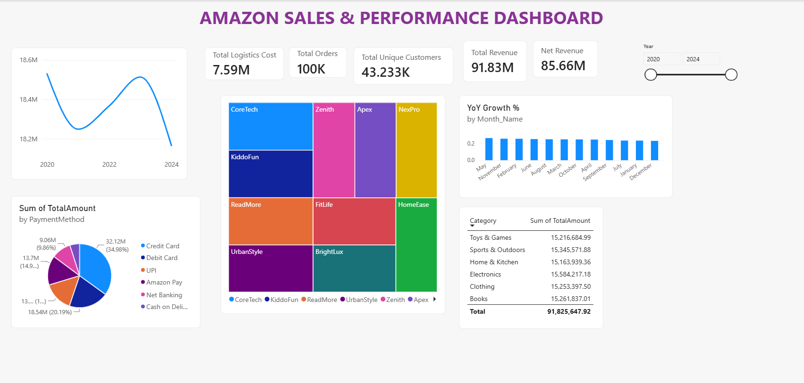

# 🛒 Amazon E-Commerce End-to-End Data Pipeline & Analytics

An end-to-end data analytics project processing over **100,000 transactional records (2020–2024)** using Python, MySQL Workbench, and Power BI. This pipeline demonstrates automated data cleaning, database schema design, advanced SQL querying, custom DAX metrics, and executive visual analytics.

---

## 📸 Executive Dashboard Preview



---

## 🛠️ Tech Stack & Architecture

- **Data Engineering & Cleaning:** Python (`pandas`, `numpy`)
- **Database & Querying:** MySQL Workbench (Relational Database)
- **Data Visualization & Analytics:** Power BI Desktop (DAX, Power Query)
- **IDE:** Visual Studio Code

## 📂 Project Workflow

### 1. Data Cleaning & Feature Engineering (Python)
- Loaded 100K order records and handled missing values across transaction attributes.
- Parsed datetime fields into standard ISO formats and engineered `Year` and `Month_Name` columns for time-series analysis.
- Removed duplicate orders and validated numeric fields (`TotalAmount`, `Discount`, `ShippingCost`, `Tax`).
- Exported clean output to `amazon_cleaned.csv`.

### 2. Database Schema & SQL Analytics (MySQL)
- Created the relational schema `amazon_db` and ingested the cleaned dataset.
- Wrote analytical queries targeting key business operational domains:
  - **YoY Order Growth:** Used SQL window functions (`LAG() OVER()`) to measure annual volume shifts.
  - **Customer Retention:** Evaluated repeat purchases vs. single-order churn risks via subqueries.
  - **Seasonality Identification:** Aggregated order volumes by month to pinpoint surge periods.
  - **Inventory Pareto Analysis:** Applied `DENSE_RANK()` to rank product SKUs by overall order throughput.

### 3. Interactive Business Intelligence (Power BI & DAX)
- Ingested cleaned data into Power Query for data type definitions and column structure setup.
- Constructed core DAX measures using iterators (`SUMX`), dynamic aggregations (`DISTINCTCOUNT`), and safe division (`DIVIDE`):
  - **Total Revenue:** `SUM(amazon_cleaned[TotalAmount])`
  - **Net Revenue:** `SUMX(amazon_cleaned, amazon_cleaned[TotalAmount] * (1 - amazon_cleaned[Discount]))`
  - **Average Order Value (AOV):** `DIVIDE([Total Revenue], [Total Orders], 0)`
  - **Unique Customer Count:** `DISTINCTCOUNT(amazon_cleaned[CustomerID])`
 
 ---

## 📊 Key Executive Dashboard Insights

- **Revenue Overview:** Total gross revenue reached **$91.83M** ($85.66M Net post-discounts) across **100K total orders**.
- **Customer Acquisition:** **43.23K unique active customers** with an Average Order Value (AOV) of **$918.26**.
- **Payment Preferences:** Credit Cards and Debit Cards account for the majority share (~55%) of payment preferences, followed by UPI and Net Banking.
- **Brand Performance:** CoreTech, Zenith, and Apex lead revenue contributions across product categories.

---

## 🚀 How to Run This Project

1. **Clone the repository:**
   ```bash
   git clone [https://github.com/your-username/amazon-ecommerce-analytics.git](https://github.com/your-username/amazon-ecommerce-analytics.git)
   cd amazon-ecommerce-analytics

- Execute Data Cleaning:
Bash
python clean_data.py

- Import to MySQL:
Execute database creation scripts in MySQL Workbench to initialize amazon_db.
Run the import wizard on amazon_cleaned.csv.

- Open Power BI Dashboard:
Open Amazon_Sales_Dashboard.pbix in Power BI Desktop to inspect DAX measures and interact with visuals.

- Click **Commit changes** at the top-right corner to save.
